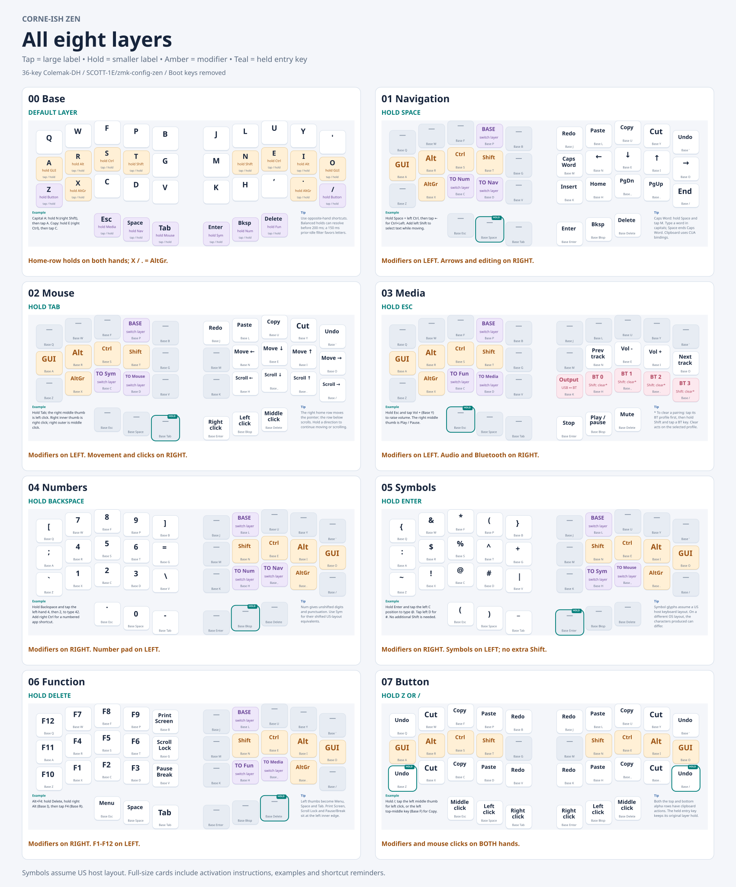

# Corne-ish Zen v2 - Colemak-DH + ZMK Studio

A 36-key Colemak-DH configuration for the **Corne-ish Zen v2 (GB R3)**,
editable over USB in [ZMK Studio](https://zmk.studio/).
Based on [velochad's fork](https://github.com/velochad/zmk-config-zen) of
[matburt's config](https://github.com/matburt/zmk-config-zen).

This version has the eight Miryoku layers below. The additional Game and GameNum
layers and their entry key have been removed. The native keymap, Studio unlock
combo, and display configuration are retained. All six Bootloader key bindings
are disabled; use the physical reset buttons when flashing firmware.



## Build your firmware

1. Open this repository's [Actions tab](https://github.com/SCOTT-1E/zmk-config-zen/actions).
2. If GitHub says workflows are disabled for this fork, click
   **I understand my workflows, go ahead and enable them**.
3. Select the workflow from `.github/workflows/build.yml`, choose **Run workflow**,
   select **main**, and run it. Future pushes to the repo also start builds.
4. Wait for all build jobs to finish successfully, open that run, and download
   its **firmware** artifact ZIP.

The matrix in [build.yaml](build.yaml) names these three firmware files:

| File | Purpose |
| --- | --- |
| `corneish_zen_left_studio.uf2` | Left half, with ZMK Studio support. Use this for Studio. |
| `corneish_zen_right.uf2` | Right half, used with either left build. |
| `corneish_zen_left.uf2` | Optional left build without Studio. |

Only the central/left half needs the Studio USB snippet and
`CONFIG_ZMK_STUDIO=y`. The build matrix enables both on the Studio variant.

## Flash and connect

These board targets are for the **Zen v2**. The selected physical layout has
**36 keys / five columns per half**. A Zen v1 or a different physical layout
requires an adjusted configuration.

1. Connect the right half over USB, double-tap its reset button to enter the
   bootloader, and copy `corneish_zen_right.uf2` to its mounted drive.
2. Repeat for the left half using `corneish_zen_left_studio.uf2`.
3. Connect the left half with a USB data cable.
4. Open [ZMK Studio](https://zmk.studio/) in **Chrome or Edge**, select the USB
   connection, and choose the keyboard's serial device.
5. Unlock editing by pressing both **outer thumb keys** together, within 50 ms.
   These are the Base **Esc** and **Delete** positions.
6. Edit your keys and save the changes to the keyboard.

If Studio cannot connect while the keyboard is also paired over Bluetooth,
use the Media layer's Output key to select USB output, then reconnect.
The [official Studio documentation](https://zmk.dev/docs/features/studio)
also describes the native app and connection requirements.

## The eight layers

| Index | Layer | Activate from Base | Main use |
| --- | --- | --- | --- |
| 0 | Base | Default | Colemak-DH typing and home-row modifiers |
| 1 | Nav | Hold left middle thumb / Space | Arrows, editing, clipboard, Caps Word |
| 2 | Mouse | Hold left inner thumb / Tab | Pointer movement, scrolling, mouse clicks |
| 3 | Media | Hold left outer thumb / Esc | Audio, Bluetooth profiles, USB/BT output |
| 4 | Num | Hold right middle thumb / Backspace | Number pad and punctuation |
| 5 | Sym | Hold right inner thumb / Enter | Shifted symbols |
| 6 | Fun | Hold right outer thumb / Delete | F1-F12 and system keys |
| 7 | Button | Hold Z or / | Clipboard and mouse clicks on either hand |

Release a layer thumb to return to Base during normal momentary use.
Layer switches represented by `&to` in the source select another layer; use its **BASE** key to return to typing. These are layer switches,
not dedicated lock/toggle behaviors. A same-layer `&to` can be canceled when
the original thumb hold is released.

### Base modifiers

Tap these keys for their letter; hold them for their modifier:

| Modifier | Left-hand key | Right-hand key |
| --- | --- | --- |
| GUI / Windows / Command | A | O |
| Alt / Option | R | I |
| Ctrl | S | E |
| Shift | T | N |
| Right Alt / AltGr | X | . |

The positional hold-taps favor opposite-hand shortcuts and use the upstream
fork's existing balanced behavior: a 200 ms tapping term, 175 ms quick-tap,
and 150 ms prior-idle requirement. Cross-hand nested shortcuts can resolve
before the tapping term expires. Pressing a home-row modifier immediately
after another letter can force its letter action instead.

The current thumb keys are listed above. A dedicated thumb Shift is a
separate remap: its existing tap/layer functions need another location.

### Symbols and host keyboard layout

Keep the host on a US-compatible layout such as U.S. / ABC: the firmware
already produces the Colemak-DH letter arrangement. The symbol legends assume
US punctuation. For example, on Sym, the Base C position is `@` and Base D is
`#`.

## Studio edits and GitHub are separate

- The repository's `.keymap` file defines the compiled stock layout.
- Studio saves live edits on the keyboard. Those saved edits can override the
  compiled layout across firmware flashes.
- To apply a changed stock keymap after using Studio, save a record of any
  live edits you want to keep, then use Studio's **Restore Stock Settings**.
- Studio changes do not automatically update this GitHub repository.
- Combos, hold-tap timing, custom behavior definitions, and build options are
  maintained in the source files and require a rebuild.

See [ZMK's keymap persistence notes](https://zmk.dev/docs/features/studio#keymap-changes).

## Clipboard on Windows/Linux and macOS

The compiled clipboard keys currently use Miryoku's CUA bindings:
Paste = Shift+Insert, Copy = Ctrl+Insert, Cut = Shift+Delete,
Undo = `K_UNDO`, and Redo = `K_AGAIN`. Application support varies.

For Mac clipboard shortcuts, replace the five `U_...` definitions near the
top of [config/corneish_zen.keymap](config/corneish_zen.keymap) with:

```c
#define U_RDO &kp LS(LG(Z))
#define U_PST &kp LG(V)
#define U_CPY &kp LG(C)
#define U_CUT &kp LG(X)
#define U_UND &kp LG(Z)
```

The normal GUI holds already act as Command on macOS, and Alt acts as Option.
Bluetooth profile selection does not automatically change the keyboard's
clipboard bindings for a different OS.

## Bluetooth profiles

Hold Esc for Media. Its right bottom row contains **Output**, then **BT 0-3**.

- Tap a BT key without Shift to select that profile.
- To clear a pairing, **select the intended profile first**, then hold Shift
  and tap a BT profile key.

All four shifted BT keys invoke `BT_CLR`, which clears the **currently selected**
profile. A shifted key does not select its own numbered profile first.
After clearing, pair the keyboard from the intended computer.

## Source files

| File | Purpose |
| --- | --- |
| [config/corneish_zen.keymap](config/corneish_zen.keymap) | Layout, eight layers, custom behaviors, Studio unlock |
| [config/corneish_zen.conf](config/corneish_zen.conf) | Pointing, e-ink display, sleep, Bluetooth |
| [config/west.yml](config/west.yml) | ZMK source; keeps the display-patch fork used by the display options |
| [build.yaml](build.yaml) | Normal left, normal right, and Studio-enabled left builds |
| [.github/workflows/build.yml](.github/workflows/build.yml) | Push, pull request, and manual GitHub Actions builds |

The [eight-layer cheat sheet](assets/keymap-layers.svg) matches this compiled
Colemak-DH keymap, with the Boot keys removed. Saved Studio edits need to be
recorded in the `.keymap` file before they can be reflected in this diagram.

